<div align="center">

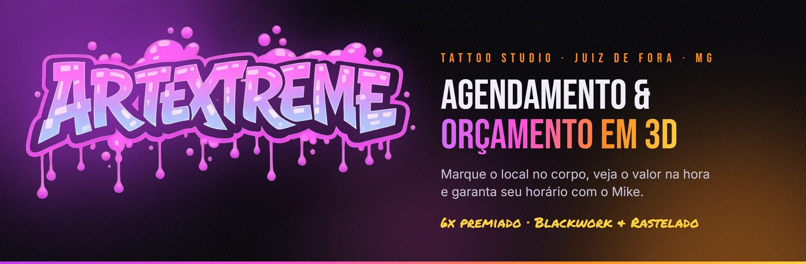

<br>


<br>

### Tatuagem boa começa antes da agulha. ✦

O app da **ArtExtreme Tattoo Studio**: o cliente marca o local no **corpo 3D**, vê o **valor na hora**<br>
e reserva o horário com o **Mike**. Sem ficar perguntando "quanto fica?" no direct.

<br>

[**▶ Demo no computador**](docs/media/ArtExtreme-demo-computador.mp4) &nbsp;•&nbsp;
[**📱 Demo no celular**](docs/media/ArtExtreme-demo-celular.mp4) &nbsp;•&nbsp;
[**✦ @tattooartextremee**](https://instagram.com/tattooartextremee)

</div>

<br>

## 🎬 Veja rodando

<div align="center">
  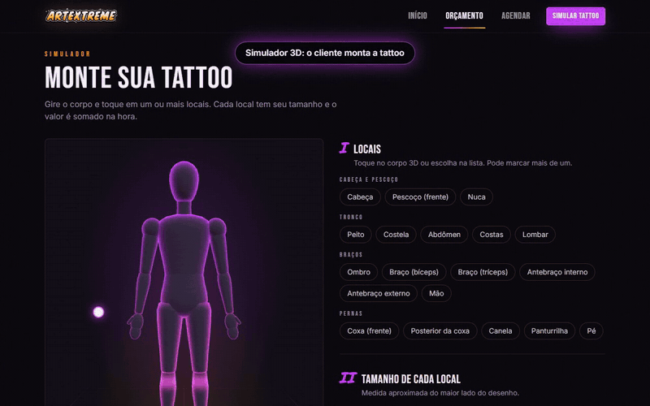
  <br>
  <sub>Marca a coxa pela frente, vira de costas, marca a posterior e gira o corpo. O valor soma sozinho.</sub>
</div>

> 🎥 Os vídeos completos estão em [`docs/media`](docs/media): **computador** (2min, tour com painel do artista) e **celular** (1min, do simulador ao "instalar app").

<br>

## ✦ A história

O **Mike** é carioca, tatua desde **2015** e fundou a ArtExtreme em **2017**. Hoje atende em **Juiz de Fora/MG** e é **6x premiado** em **Blackwork** e **Rastelado** 🥇🥇🥇🥇🥈🥉.

Ele é fascinado por tecnologia (os desenhos nascem no Photoshop, Concepts e ArtFlow antes de chegar na pele), então nada mais justo que o estúdio ter um app à altura. A ideia é simples: resolver as duas perguntas que mais chegam no WhatsApp de qualquer tatuador.

| 💬 "Quanto fica?" | 📅 "Tem horário?" |
| :--- | :--- |
| O cliente marca **um ou mais locais** no corpo 3D, escolhe tamanho, estilo e cor, e recebe uma **faixa de valor na hora**, calculada pela tabela do próprio Mike. | O cliente vê só os horários **realmente livres** (considerando quanto tempo a sessão leva) e o pedido sai **pronto no WhatsApp** do estúdio. |

<br>

## 🔥 O que tem dentro

### Para quem quer tatuar

- 🧍 **Corpo 3D interativo** com visual neon de holograma. Gira, dá zoom e tem atalhos de frente, lados e costas.
- 🎯 **Marcação precisa**: frente e trás são áreas diferentes (bíceps/tríceps, antebraço interno/externo, coxa/posterior, canela/panturrilha, pescoço/nuca).
- ➕ **Vários locais num pedido só**, cada um com seu tamanho. Valor e tempo de sessão somam automaticamente, com detalhamento por local.
- 💸 **Estimativa na hora**: faixa de valor, duração da sessão e sinal.
- 🖼️ **Portfólio em esteira infinita** de ponta a ponta da tela, com pausa/play e arraste. Cada foto abre o post no Instagram.
- 📅 **Agendamento** com dias e horários livres, de acordo com o expediente, as folgas e a duração de cada sessão.
- 💬 **WhatsApp**: o pedido vira uma mensagem prontinha para o estúdio.
- 🩹 **Guia de cuidados pós-tattoo**, com o passo a passo do próprio Mike.
- 📲 **Instala como app** no Android e no iPhone (PWA), com botão "Instalar app", tela cheia e navegação inferior.

### Para o Mike (`/admin`)

- 🗓️ **Agenda** com status (pendente, confirmado, concluído, cancelado), indicadores e atalho para chamar o cliente.
- 🏷️ **Tabela de preços 100% editável**:
  - **Tamanhos**: faixas em cm, valor base e duração da sessão
  - **Áreas do corpo**: ajuste em % por região (costela dói mais, cobra mais 😅)
  - **Estilos**: ajuste por complexidade e marcação das especialidades em destaque
  - **Regras gerais**: valor mínimo, adicional de cor, margem da estimativa e % do sinal, com **exemplo de cálculo ao vivo**
- ⚙️ **Configurações**: dados do estúdio, dias e horários, folgas, PIN e backup em JSON.

<br>

## 🧮 Como o preço é calculado

```text
valor de cada local = base da faixa × ajuste da área × ajuste do estilo × (colorida ? ajuste de cor : 1)
                      └─ respeitando o valor mínimo por tattoo
total               = soma dos locais
o cliente vê        = total ± margem
```

Tudo isso mora em [`src/lib/pricing.ts`](src/lib/pricing.ts), coberto por testes. Ninguém quer orçamento errado. ✅

<br>

## 📸 Telas

| Simulador 3D | No celular |
| :---: | :---: |
| 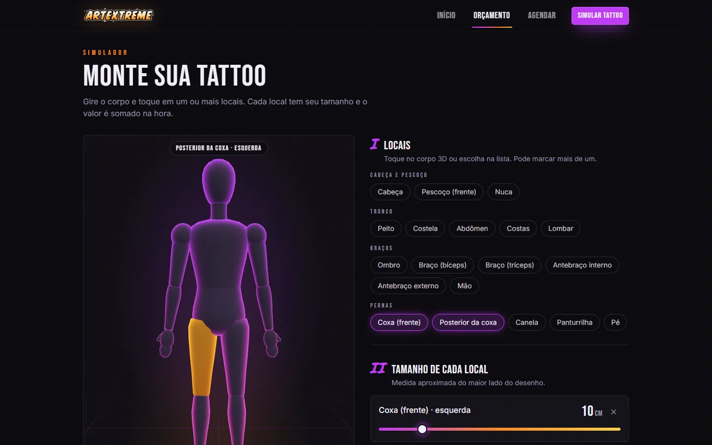 | 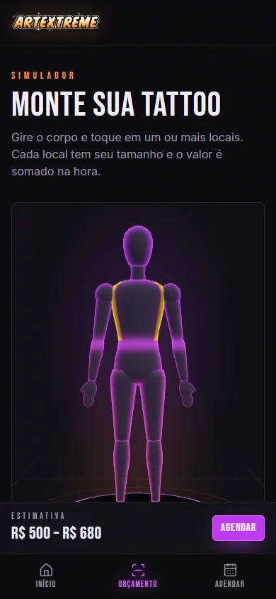 |

| Página inicial | O artista |
| :---: | :---: |
| 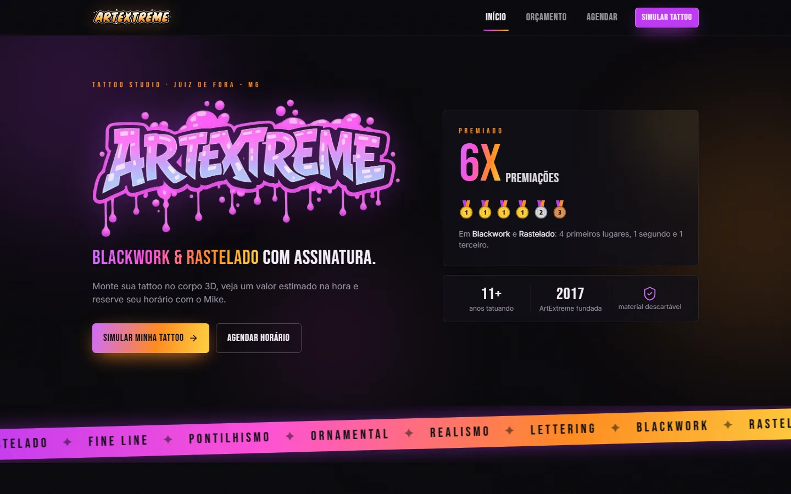 | 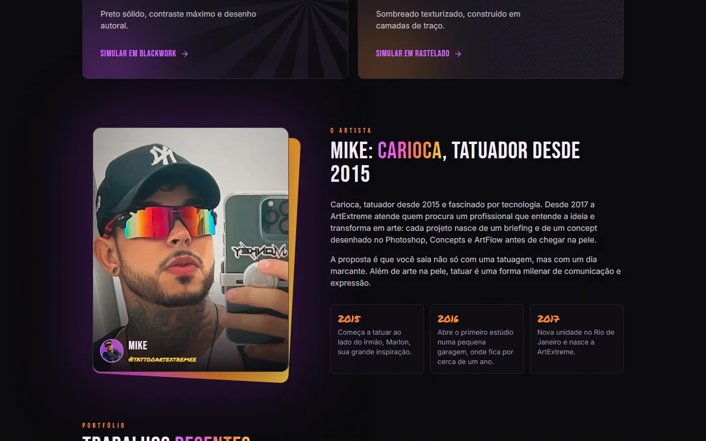 |

| Portfólio em esteira infinita |
| :---: |
| 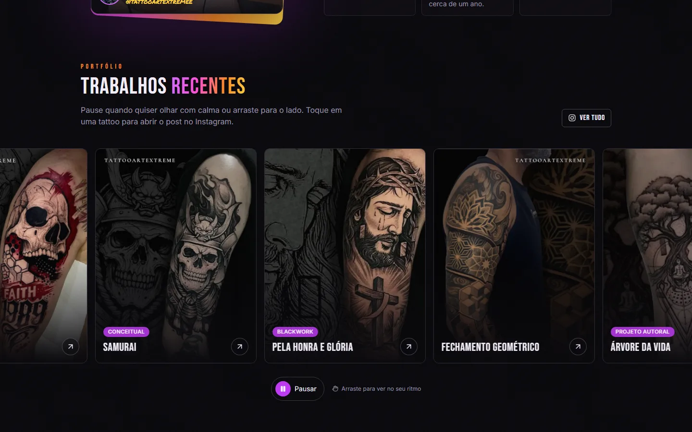 |

| No tablet | Painel do Mike no celular |
| :---: | :---: |
| 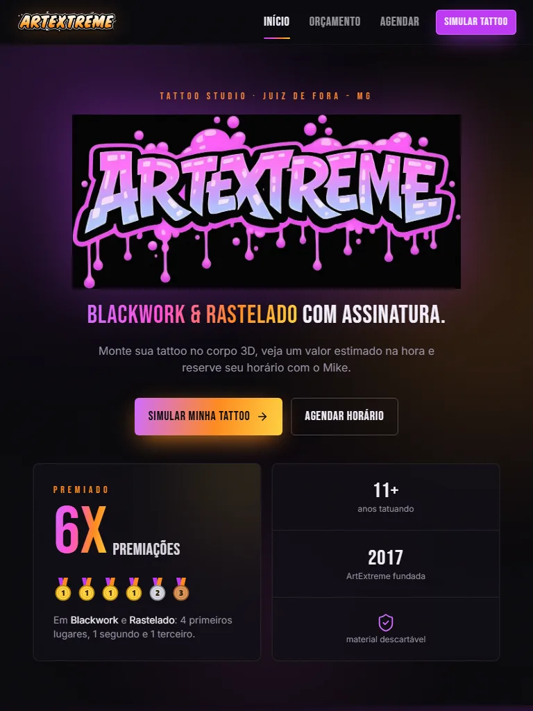 | 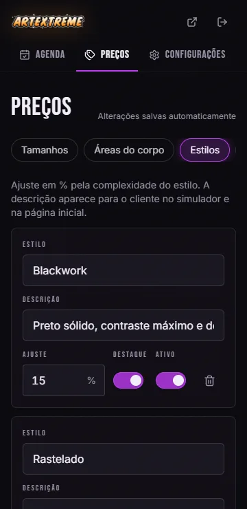 |

<sub>Testado em celular (360 e 390 px), tablet em pé e deitado (768, 820 e 1024 px) e desktop (1440 px), sem rolagem lateral em nenhum deles.</sub>

<br>

## 🎨 Identidade visual

Preto profundo com neon de **rave**: o roxo vem da marca, o laranja e o amarelo vêm do lettering oficial e o rosa vem do grafite.

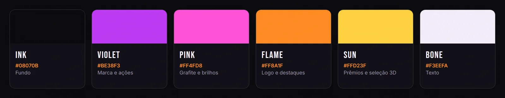

| Fonte | Onde |
| :--- | :--- |
| **Bebas Neue** | Títulos e botões |
| **Permanent Marker** | Detalhes com cara de grafite (anos, números) |
| **Inter** | Textos |

O corpo 3D é **gerado por código** (geometrias de revolução e cápsulas), sem modelo baixado. Fica leve, sem problema de licença, e cada região é uma malha clicável. O visual neon usa um **shader próprio**: contorno fresnel, faixa de "scanner" subindo pelo corpo e pulso na área escolhida.

<br>

## 🛠️ Stack

| Camada | Tecnologia |
| :--- | :--- |
| Interface | React 19 · TypeScript · Tailwind CSS 4 |
| 3D | Three.js · React Three Fiber · Drei · shader GLSL próprio |
| Estado | Zustand (persistido, com migração de versões) |
| Rotas | React Router 7, com páginas carregadas sob demanda |
| App | vite-plugin-pwa: instalável, cache offline e atalhos |
| Qualidade | Vitest · checagem de tipos no build |

<br>

## 🗂️ Estrutura

```text
src/
├── components/
│   ├── body3d/          🧍 corpo 3D: zonas, manequim, shader neon, câmera e palco
│   ├── layout/          🧱 layout do site e do painel
│   ├── ui/              🎛️ botões, campos, medalhas, ícones
│   ├── WorksCarousel    🖼️ esteira infinita do portfólio
│   └── InstallAppButton 📲 "instalar app" (Android e iPhone)
├── data/                📦 preços iniciais, textos do estúdio e portfólio
├── hooks/               🪝 useEstimate (estado derivado do simulador)
├── lib/                 🧮 regras puras: preço, agenda, WhatsApp, formatação
├── pages/               📄 home, simulador, agendamento e painel
├── store/               🗃️ estado global persistido
└── types/               🔤 tipos do domínio
```

<br>

## 🚀 Rodando na sua máquina

```bash
npm install
npm run dev        # http://localhost:5173
```

| Script | O que faz |
| :--- | :--- |
| `npm run dev` | Servidor de desenvolvimento |
| `npm run build` | Checa os tipos e gera o build de produção |
| `npm run preview` | Serve o build localmente |
| `npm test` | Roda os testes |
| `npm run icons` | Gera favicon e ícones do app a partir do logo |

> 🔐 Painel do artista em `/admin`. O PIN de demonstração é **1234**. Nesta versão os dados ficam no aparelho e o PIN é só uma trava de interface. O login de verdade chega com o Supabase (veja o roadmap).

<br>

## 🗺️ Roadmap

- [x] Simulador 3D com vários locais e marcação frente/trás
- [x] Estimativa somada, agendamento e integração com WhatsApp
- [x] Painel: agenda, preços e configurações
- [x] Identidade visual da ArtExtreme, portfólio e guia de cuidados
- [x] PWA instalável no Android e no iPhone
- [ ] **Supabase**: agenda compartilhada entre clientes e o Mike
- [ ] **Login do Mike** por e-mail e senha, com **"esqueci minha senha"**
- [ ] **Aba Portfólio** no painel: subir fotos pelo celular, escolher estilo e ordem
- [ ] Deploy na Vercel com domínio próprio
- [ ] Notificação de novo pedido para o Mike

<br>

## 🙌 Créditos

<div align="center">

**Arte, marca, fotos e tatuagens**: ArtExtreme Tattoo Studio · Mike ([@tattooartextremee](https://instagram.com/tattooartextremee))<br>
**Design e desenvolvimento**: [Leon Hauck](https://www.linkedin.com/in/leon-hauck/)

<sub>O código está aberto para fins de portfólio. Logo, fotos e trabalhos pertencem à ArtExtreme e não podem ser reutilizados.</sub>

<br><br>

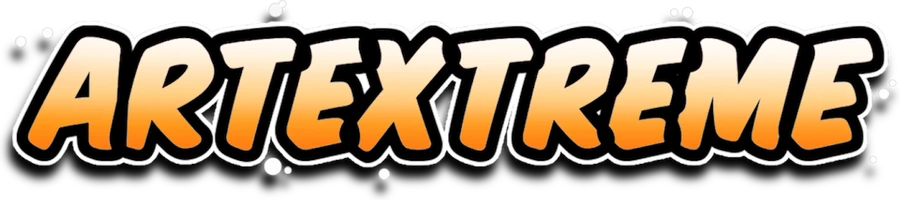

</div>
